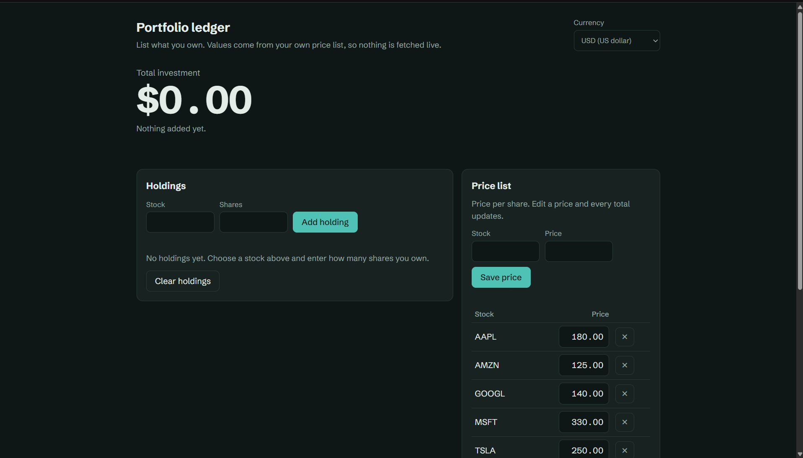
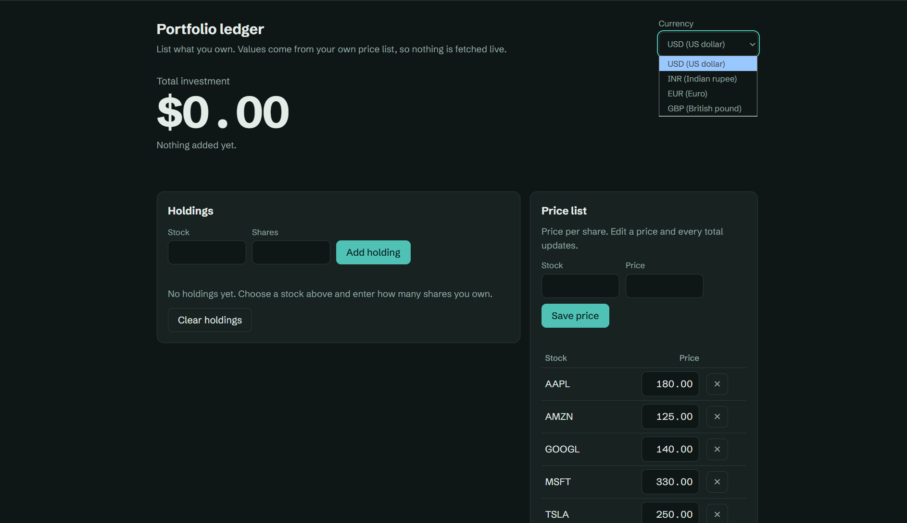
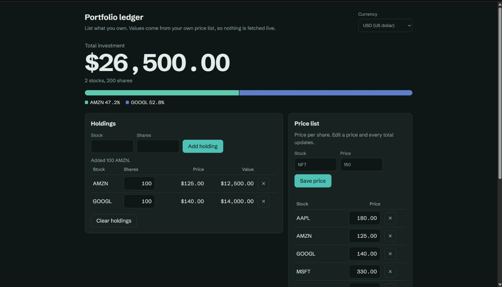
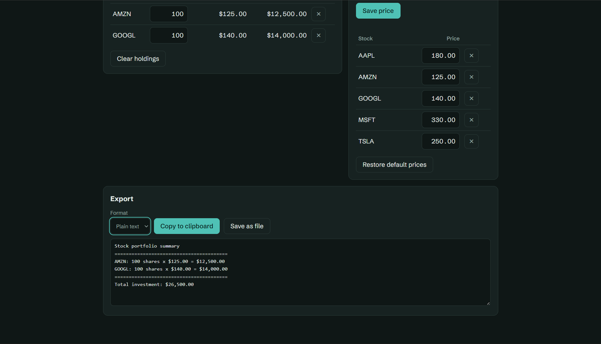

# 📈 Stock Portfolio Tracker

A simple stock portfolio tracker that calculates your **total investment** from manually defined stock prices. It comes in two forms:

- **Portfolio ledger**: a web app (HTML, CSS, JavaScript) served by a small Python backend.
- **Console version**: a plain Python script that runs in the terminal.

Built as **Task 2** for [CodeAlpha](https://www.codealpha.tech/).

## Screenshots

| Dashboard | Currency switcher | Investment Calculator | Export |
|---|---|---|---|
|  |  | |  |

## Features

- Enter a stock name and quantity to add a holding. Adding the same stock again merges into one line.
- Prices come from a **hardcoded price list** (AAPL, TSLA, GOOGL, MSFT, AMZN) that you can edit, extend or delete in the app.
- Total investment and per-stock values update instantly.
- A colour bar shows each stock's share of the total.
- Switch the display currency between USD, INR, EUR and GBP. This changes formatting only, not the prices.
- Input validation: unknown stocks, non-numeric or negative quantities, and invalid prices are rejected with a clear message.
- Money is calculated in whole cents, so floating-point rounding errors cannot creep in.
- Export the summary as **CSV** or **plain text**: copy it, or save it as `portfolio.csv` / `portfolio.txt`.
- Holdings and prices are remembered in your browser between visits.

## Concepts used

Dictionaries, input/output, basic arithmetic, input validation, file handling.

## Project structure

```
CodeAlpha_Task_2/
├── app.py                      # Python server for the web app (standard library only)
├── index.html                  # Web app: page, styles and JavaScript
├── stock_portfolio_tracker.py  # Console version
├── screenshots/                # Images used in this README
└── README.md
```

## Requirements

- Python 3.7 or newer
- A web browser
- No packages to install

The page loads one font from Google Fonts. Without an internet connection it falls back to a system font and everything still works.

## How to run

### Web app

```bash
python app.py
```

On Windows, use `py app.py` if `python` is not recognised.

Your browser opens at `http://127.0.0.1:8000`. If that port is busy, the server tries the next free port (up to 8019) and prints the address it chose. Press `Ctrl+C` in the terminal to stop it.

The **Save as file** button writes `portfolio.csv` or `portfolio.txt` into the project folder. Opening `index.html` directly also works, but saving to a file needs `app.py` running.

### Console version

```bash
python stock_portfolio_tracker.py
```

Type a stock name and quantity, repeat for each holding, then type `done`. It prints a table with the total investment and offers to save the result as `portfolio.txt` or `portfolio.csv`.

## Example

| Stock | Shares | Price | Value |
|---|---|---|---|
| AMZN | 100 | $125.00 | $12,500.00 |
| GOOGL | 100 | $140.00 | $14,000.00 |
| **Total** | | | **$26,500.00** |

## Changing the prices

- **In the web app:** edit any price in the Price list panel, or add a new stock with **Save price**.
- **In the console version:** edit the `STOCK_PRICES` dictionary at the top of `stock_portfolio_tracker.py`.

## Author

[@Tuhintech1278](https://github.com/Tuhintech1278)
